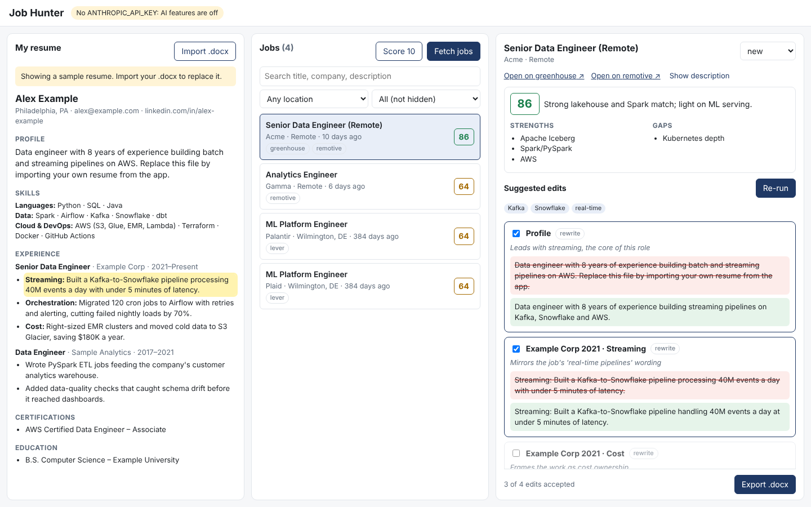

# Job Hunter

A personal job-search workbench: your resume on the left, open jobs from several
sources in the middle, and on the right a Claude-tailored version of your resume
for the job you pick. You review every suggested edit, then export a `.docx`.



_Screenshot with the sample resume and sample jobs._

## What it does

1. **Fetches jobs** from company job boards (Greenhouse, Lever), Remotive (remote
   roles) and Adzuna (US aggregator), filters them by title, and merges
   duplicates of the same posting across sources.
2. **Scores each job** against your resume (0–100, with strengths and gaps) using
   Claude, so the list is sorted by fit.
3. **Tailors your resume** to a job. Claude proposes rewrites, removals and a
   better bullet order, **using only what is already on your resume**. The server
   blocks edits that add skills and flags any number that isn't in the original.
4. **Exports** the accepted version as a Word document, and tracks each job's
   status (saved → applied → interview → offer / rejected).

## Run it

Needs Python 3.12+ and Node 18+.

```bash
cp .env.example .env          # add ANTHROPIC_API_KEY (and optionally Adzuna keys)
python -m venv .venv && source .venv/bin/activate
pip install -r backend/requirements.txt
cd frontend && npm install && cd ..
```

Development (two terminals):

```bash
cd backend && uvicorn app.main:app --reload --port 8000
```

```bash
cd frontend && npm run dev    # open http://localhost:5173
```

Or build the front end once and let FastAPI serve everything on :8000:

```bash
cd frontend && npm run build && cd ../backend && uvicorn app.main:app --port 8000
```

Then in the app: **Import .docx** (your resume) → **Fetch jobs** → **Score 10** →
pick a job → **Tailor my resume** → tick the edits you want → **Export .docx**.

## Configure

- `config/sources.json`: which companies to follow (the slug from
  `boards.greenhouse.io/<slug>` or `jobs.lever.co/<slug>`), search terms,
  Adzuna location, and title include/exclude filters.
- `.env`: `ANTHROPIC_API_KEY` (required for AI), `ADZUNA_APP_ID` /
  `ADZUNA_APP_KEY` (free at developer.adzuna.com), `JOBHUNTER_MODEL`,
  `JOBHUNTER_REFRESH_HOURS` (background refresh, `0` to turn off).

Your resume and the job database live in `data/`, which is git-ignored.

## Tests

```bash
cd backend && pytest
```

The tests use recorded API responses and a fake Claude, so they run offline and
cost nothing. `cd frontend && npm run typecheck` checks the front end.

## Layout

```
backend/app/
  sources/      one adapter per job source (parse() is pure and tested)
  ingest.py     fetch all sources → title filter → dedupe → store
  dedupe.py     normalize company/title/location into a stable key
  ai.py         the Claude calls (import, score, tailor) with structured outputs
  tailoring.py  guardrails on Claude's edits, and applying accepted ones
  export.py     .docx in (text) and out (formatted resume)
  db.py         SQLite: jobs, scores, tailored results
  main.py       FastAPI routes + background refresh loop
frontend/src/   React + TypeScript three-panel UI
docs/           design decisions
CHANGELOG.md    what changed, release by release
```

See [docs/decisions.md](docs/decisions.md) for why it is built this way.
